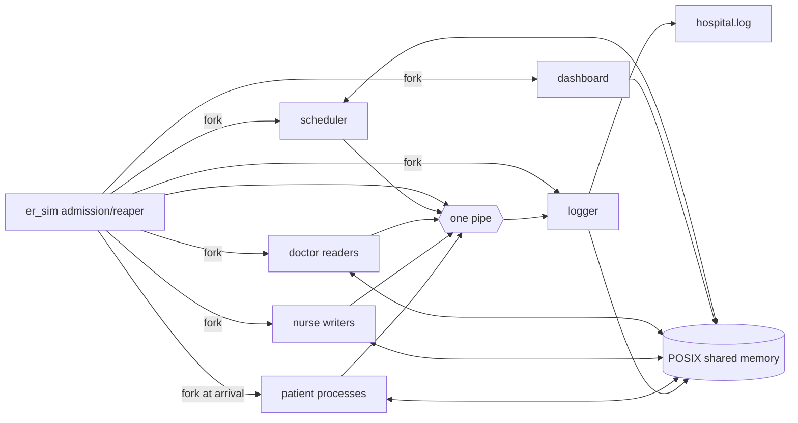

# Hospital ER Simulator

A menu-driven, multi-process C11 simulation for the Operating Systems Laboratory (AID20090). Patients are processes, one scheduler owns the treatment clock, one logger consumes a shared pipe, and POSIX shared memory holds process-shared semaphores and all observable state.

## Requirements and build

Use Linux or WSL2 with GCC and GNU Make:

```bash
sudo apt install build-essential
make
make test
make smoke
make integration
```

The build uses `-std=c11 -Wall -Wextra -Werror -O2 -pthread` and `-lrt`. `make asan` creates an AddressSanitizer/UndefinedBehaviorSanitizer build. `make clean` removes generated binaries, logs, and stale shared memory.

## Run

```bash
./er_sim --scenario scenarios/er_rush.csv
./er_sim --scenario scenarios/classic.csv --policy srtf --no-ui --fast
./er_sim --scenario scenarios/classic.csv --policy fcfs --no-ui --fast
./er_sim --demo cache
./demo.sh
```

The dashboard needs a terminal of at least 100 columns by 32 rows. `--no-ui` makes the logger echo the event stream and is useful for scripts.

| Option | Meaning |
|---|---|
| `--scenario FILE` | Load a validated scenario (required except for cache demo) |
| `--policy srtf\|fcfs` | Override the scenario scheduling policy |
| `--tick-ms N` | Set treatment tick duration |
| `--fast` | Use 50 ms ticks |
| `--no-ui` | Disable dashboard and echo logger events |
| `--no-sync` | Deliberately disable records readers-writers synchronization |
| `--cache-size N` | Override FIFO/LRU frame count |
| `--seed N` | Set deterministic worker seeds (default 42) |
| `--demo cache` | Replay the manual reference string |
| `--help` | Show usage |

Successful simulations return 0, invalid input returns 1, and failed system calls or a detected stuck state return 2. An interrupted run performs cleanup and returns 130.

## Process and data flow



The pipe exists before any fork. Every event is at most 256 bytes and is sent in one `write`, safely below `PIPE_BUF`, so events from different writers do not interleave. The main process keeps its writer open until all other writers are reaped; closing it then gives the logger EOF.

## Scenario format

Blank lines and `#` comments are ignored. Configuration lines use `@key=value`:

```text
@policy=srtf
@tick_ms=300
@ventilators=5
@total_blood=6
@total_icu=3
@total_surgery=2
@readers=3
@writers=2
@cache=4
```

Each patient row contains exactly 15 integers:

```text
id,arrival,burst,severity,needs_vent,max_b,max_i,max_s,req1_b,req1_i,req1_s,req2_b,req2_i,req2_s,req2_at
```

The loader rejects duplicate IDs, non-positive bursts/severity, invalid field counts, requests above declared maximums, maximums above system totals, invalid second-request points, and more than 16 patients.

## Algorithms and synchronization

- SRTF reevaluates every tick, breaking ties by severity then patient ID. FCFS is non-preemptive and breaks arrival ties by ID.
- Banker's resource-request algorithm tentatively allocates blood, ICU beds, and surgery rooms, then commits only a safe state.
- Patients acquire a ventilator before requesting Banker's resources. A ventilator waiter therefore holds no Banker's allocation, preventing an invisible circular wait.
- Doctors and nurses use the first readers-writers solution. `--no-sync` exposes inconsistent `a + b != sum` reads for demonstration.
- Every doctor lookup feeds identical references to independent FIFO and LRU caches.

## Tests and demonstrations

`make test` runs pure-function tests for Banker's algorithm, FCFS/SRTF, FIFO/LRU/Optimal, and Belady's anomaly. `make smoke` checks the classic SRTF statistics. `make integration` asserts that the rush scenario contains a preemption, ventilator waiting, an unsafe Banker's denial, and a later grant to that denied patient.

The `demo.sh` menu builds and runs every course demonstration, including arithmetic, policy comparison, synchronization corruption, page replacement, fork-sort, orphan, zombie, process tree, tests, and cleanup.

See [docs/report.md](docs/report.md) for theory, flowcharts, design rationale, captured results, and viva FAQs.
