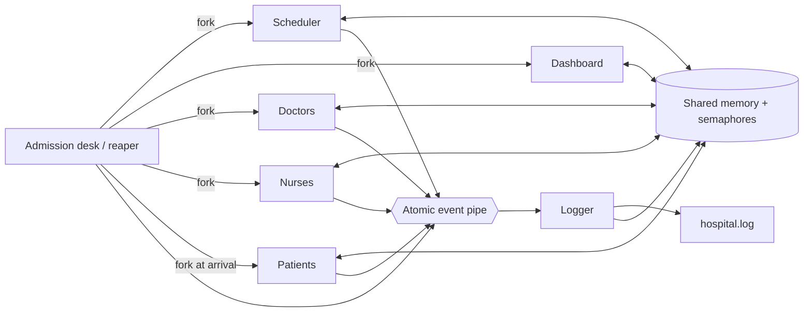
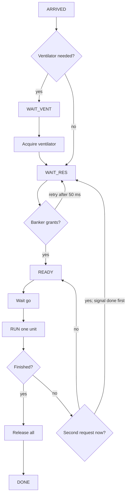
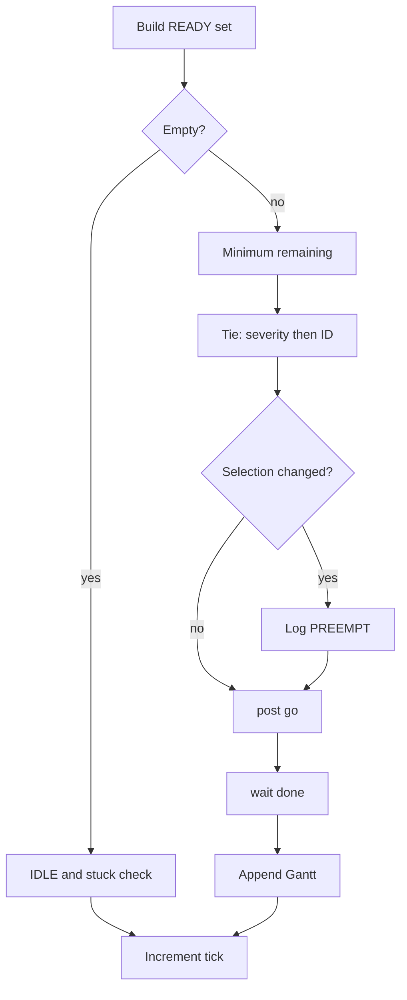
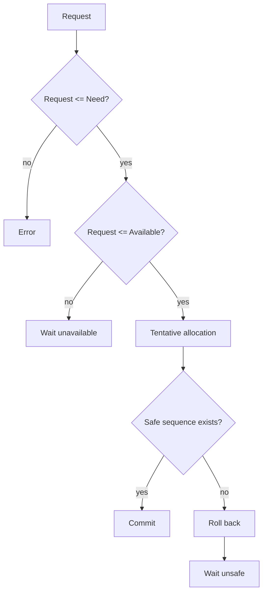
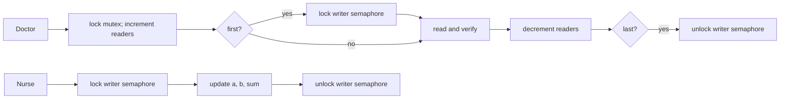
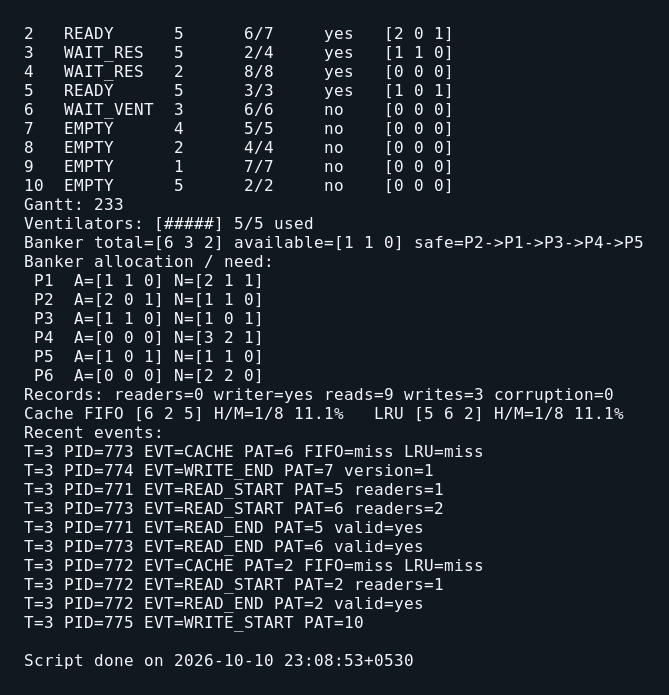
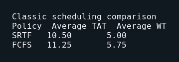
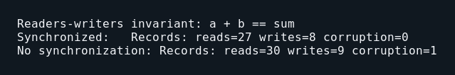
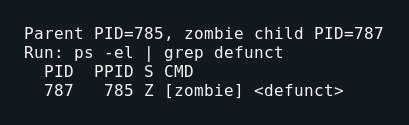

# Title

Hospital Emergency Room Simulator — Operating Systems Laboratory Mini Project

# Aim

To implement a deterministic, menu-driven hospital emergency-room simulation in C11 that demonstrates Linux scripting, processes, scheduling, pipes, deadlock avoidance, semaphores, readers-writers synchronization, and page replacement in one explainable system.

# Objectives

- Represent patients and supporting roles with processes rather than threads.
- compare FCFS and SRTF on one treatment slot;
- exchange atomic events through a pipe;
- avoid unsafe resource allocations with Banker's algorithm;
- synchronize ventilators and a shared records database with semaphores;
- compare FIFO and LRU on the same patient lookup stream; and
- provide repeatable scenarios, unit tests, demonstrations, and safe cleanup.

# Theory

## Laboratory mapping

| Assignment | Topic | Project use |
|---|---|---|
| 1 | Linux, shell, arithmetic | `demo.sh` build/run menu, `$(( ))`, `awk` |
| 2 | `fork`, wait, orphan, zombie | patient processes and `demos/` |
| 3 | FCFS and SRTF | treatment scheduler and statistics |
| 4 | Pipes | common atomic event stream to logger |
| 5 | Banker's algorithm | blood, ICU and surgery allocation |
| 6 | Semaphores/readers-writers | ventilators and records DB |
| 7 | FIFO/LRU replacement | recent-patient caches |

## Scheduling

FCFS selects the earliest arrived ready patient and keeps it until completion. SRTF selects the ready patient with the smallest remaining burst on every tick; a changed selection preempts the old patient. SRTF generally improves mean waiting time but can starve a long case if shorter cases keep arriving.

For every patient, `TAT = CT - arrival` and `WT = TAT - burst`. The classic scenario produces SRTF averages 10.50 and 5.00, compared with FCFS averages 11.25 and 5.75.

## IPC and shared memory

The parent creates one pipe before any fork. A line of no more than 256 bytes is emitted in one `write`; because this is below Linux `PIPE_BUF`, lines are atomic between writers. The logger alone reads the pipe, writes `hospital.log`, and updates the dashboard's last-ten-event ring.

One named POSIX shared-memory mapping stores all cross-process state. An unnamed semaphore must live in shared memory and be initialized with `pshared=1`; otherwise forked processes would manipulate private copies.

## Deadlock avoidance

Banker's algorithm checks whether all active patients can still finish after a tentative grant. Free resources are not enough: a grant can be refused when it removes every possible completion sequence. Ventilators are intentionally acquired before Banker's resources. A ventilator waiter therefore holds no blood, bed, or surgery allocation, so the semaphore cannot create a circular wait invisible to Banker's matrices.

## Readers-writers and caching

Doctors use the first readers-writers solution: the first reader locks writers out and the last reader releases them. A nurse exclusively updates `a`, then `b`, then `sum`. With synchronization, readers always see `a + b == sum`; `--no-sync` deliberately exposes the intermediate update.

Every doctor read references one patient. Independent FIFO and LRU states consume the same references. FIFO evicts the oldest loaded page; LRU evicts the page with the oldest access timestamp. Optimal is included only in the offline manual demonstration.

# Block diagram

# Algorithm

## Patient life cycle

## SRTF tick

## Banker's request

## Readers-writers

# Input

Input is a scenario containing `@key=value` configuration followed by 15-field patient CSV rows. The fixed `classic.csv`, `er_light.csv`, and `er_rush.csv` files cover textbook scheduling, relaxed resources, and contention respectively. Command-line flags may override policy, tick duration, cache size, synchronization, UI, and seed.

# Output

The dashboard shows the clock, running patient, patient states, Gantt strip, ventilators, Banker's matrices/safe sequence, records counters, both caches, and recent events. In `--no-ui` mode the same events are echoed and a final table reports CT, TAT, WT, averages, records counts, and cache counts.

Captured evidence is stored in `docs/screenshots/`:

- `dashboard.png` — live ER-rush dashboard;
- `policy-comparison.png` — classic SRTF/FCFS averages;
- `corruption-demo.png` — synchronized versus unsynchronized records;
- `zombie-ps.png` — defunct child before it is reaped.

# Design decisions

1. **Processes, not threads.** This directly demonstrates `fork`, independent address spaces, reaping, orphaning, and zombies.
2. **Semaphores in shared memory.** `pshared=1` synchronizes processes only when every process sees the same semaphore object.
3. **Ventilator-first ordering.** A patient never holds Banker's resources while waiting for an unmodelled semaphore resource.
4. **One atomic pipe write.** Fixed-size event lines remain intact even when many processes log concurrently.
5. **Pure algorithms.** Scheduling, Banker's logic, and cache replacement can be tested without timing or IPC.
6. **State before signal.** Patients publish `READY`, `WAIT_RES`, or `DONE` before posting `done`, preventing scheduler deadlock or stale decisions.

# Conclusion

The simulator integrates all seven laboratory topics in one deterministic, testable process system. Pure algorithm tests match the manual, the classic live schedule matches expected statistics, the rush scenario demonstrates contention and safe denial, normal records remain consistent, and `--no-sync` visibly demonstrates why exclusion is needed.

# FAQs

1. **Why is each patient a process?** The course focuses on process creation, scheduling and reaping, and independent address spaces make those concepts observable.
2. **Why must a semaphore be in shared memory?** A normal heap semaphore is copied by `fork`; process-shared synchronization requires every process to address the same object.
3. **Why can SRTF starve a long job?** Repeatedly arriving shorter jobs can always win the next preemptive choice.
4. **Why do pipe events not interleave?** Each line is written once and is smaller than `PIPE_BUF`, for which POSIX guarantees atomic pipe writes.
5. **What if a request exceeds the declared maximum?** The request algorithm returns `ERROR_EXCEEDS_MAX`; the live patient reports an error.
6. **Why can Banker refuse resources that are currently free?** The tentative state may leave no order in which all remaining maximum claims can complete.
7. **Why acquire a ventilator first?** Ventilators are outside Banker's matrices; acquiring them first prevents a patient from holding matrix resources while waiting for one.
8. **What is Belady's anomaly?** FIFO can produce more faults when given more frames; the tests show 9 faults with three frames and 10 with four.
9. **Why does the scheduler use `go` and `done` semaphores?** They create an exact one-tick handshake between the scheduler and the chosen patient.
10. **Why does the logger exit on EOF?** EOF proves every write descriptor is closed, so no process can emit another event.
11. **What does `--no-sync` demonstrate?** Readers can observe a record between field updates and detect `a + b != sum`.
12. **Why use a fixed seed?** It makes worker choices repeatable enough for demonstrations and debugging while scheduling itself remains scenario-deterministic.
